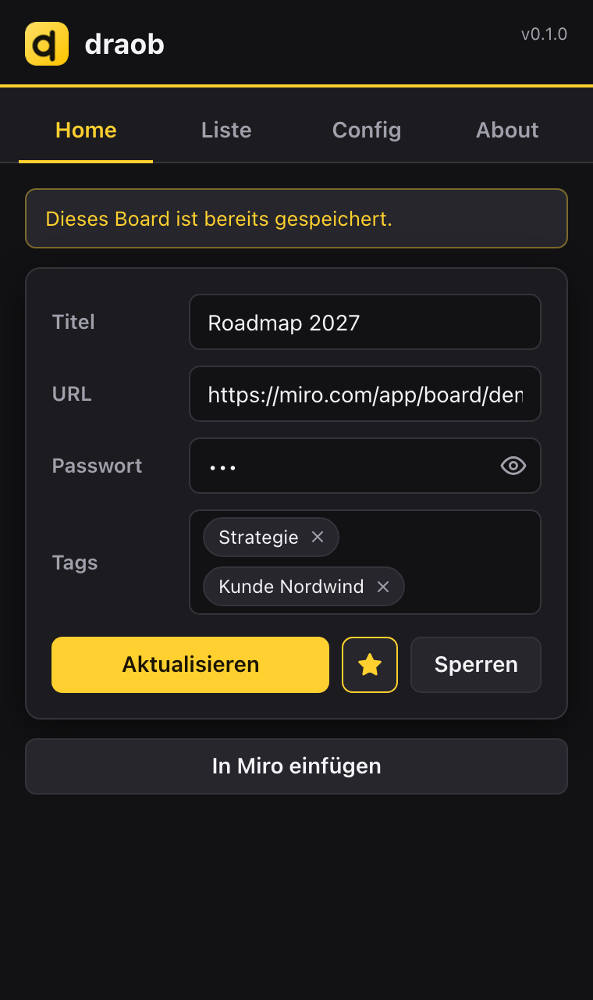
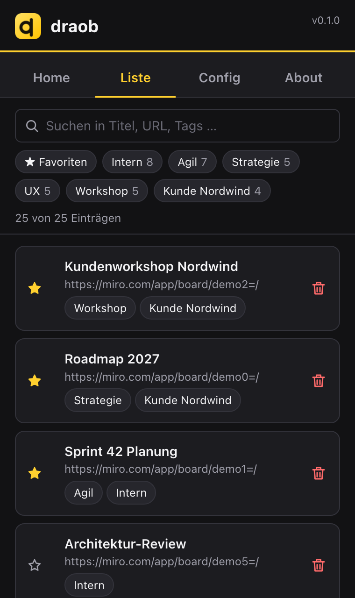
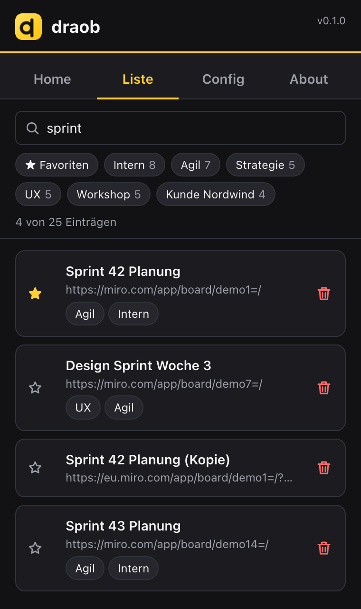

# draob testen: Handout

[Als PDF herunterladen](handout.pdf)

**draob** ist eine Chrome-Extension, die die Passwörter deiner Miro-Boards verschlüsselt speichert, das richtige Board beim Öffnen erkennt und das Passwort mit einem Klick einfügt.
Alles bleibt lokal in deinem Browser: keine Konten, kein Server, kein Tracking. draob ist ein unabhängiges Projekt und nicht mit Miro verbunden.

<table>
  <tr>
    <td align="center" width="33%"> <b>Board erkannt:</b> Eintrag da, ein Klick fügt das Passwort ein</td>
    <td align="center" width="33%"> <b>Liste:</b> Favoriten, Tags, Link-Symbol öffnet die Seite</td>
    <td align="center" width="33%"> <b>Suche:</b> findet Titel, URL und Tags sofort</td>
  </tr>
</table>

## Was kann es?

- 🎯 **Erkennt dein Board:** URL und Titel werden übernommen, bekannte Boards laden ihren Eintrag.
- ⚡ **Passwort mit einem Klick:** „In Miro einfügen“ trägt es ein. Absenden tust du selbst.
- 🔎 **Suche, Tags, Favoriten** und ein Link-Symbol, das die gespeicherte Seite in einem neuen Tab öffnet.
- 💾 **Sicherung:** den verschlüsselten Tresor als Datei speichern und wiederherstellen.

## Installieren (ca. 2 Minuten, Chrome am Computer)

draob ist noch nicht im Chrome Web Store, deshalb wird es als „entpackte Erweiterung“ geladen.

1. **ZIP laden:** auf [Releases → neueste Version](https://github.com/engelrico/draob/releases/latest) die Datei `draob-<Version>.zip` herunterladen.
2. **Entpacken** (Doppelklick). Der Ordner muss **dauerhaft liegen bleiben**, zum Beispiel in „Dokumente“. Chrome lädt die Erweiterung von dort.
3. In Chrome `chrome://extensions` öffnen und oben rechts **Entwicklermodus** einschalten.
4. **Entpackte Erweiterung laden** klicken und den entpackten Ordner wählen (der mit der Datei `manifest.json`).
5. Optional: über das Puzzle-Symbol rechts oben draob **anheften**.

## Benutzen

1. Auf das draob-Icon klicken und beim ersten Mal ein **Masterpasswort** festlegen (mindestens 8 Zeichen).
2. Miro-Board öffnen, dann das draob-Icon klicken: Titel und URL sind schon ausgefüllt, nur das Board-Passwort eintragen und speichern.
3. Beim nächsten Mal: **In Miro einfügen** klicken, in Miro bestätigen.

## Wichtig zu wissen

- **Vergisst du das Masterpasswort, sind die Daten weg.** Das ist Absicht, es gibt keine Wiederherstellung.
- draob ist ein früher Prototyp ohne unabhängige Sicherheitsprüfung. Für Hochsicherheits-Zugangsdaten nimm einen etablierten Passwortmanager.
- Chrome zeigt bei Erweiterungen im Entwicklermodus gelegentlich einen Hinweis. Den kannst du schließen.
- Der Tresor sperrt sich, wenn du Chrome schließt oder auf **Sperren** klickst.

## Update auf eine neue Version

1. Zur Sicherheit: in draob unter **Config** eine **Sicherung** exportieren.
2. Neue ZIP laden und in denselben Ordner entpacken (alte Dateien ersetzen).
3. In `chrome://extensions` bei draob auf **Neu laden** klicken. Deine Einträge bleiben erhalten.

Hast du eine Version bis v0.1.1 installiert, ändert sich die Erweiterungs-ID einmalig. Dann vor dem Umstieg die Sicherung exportieren und in der neuen Version wiederherstellen.

## Feedback

Im About-Tab von draob gibt es Links für Fehler und Ideen (GitHub oder E-Mail). Oder direkt: [Issue anlegen](https://github.com/engelrico/draob/issues/new/choose) oder an **draob@engelrico.de**. Bitte keine Passwörter oder Board-Links mitschicken.

Mehr Details: [README](../README.md)
